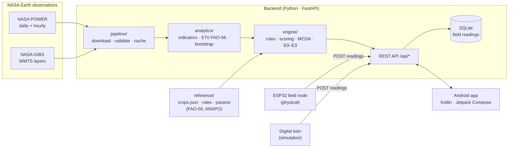
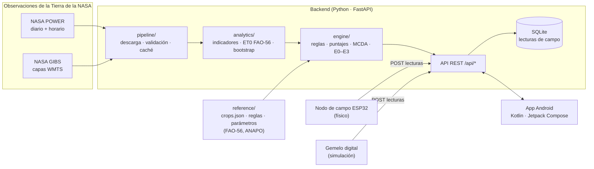

# FarmealoTu

**Crop-rotation decision support for farmers in Cuatro Cañadas (Santa Cruz, Bolivia), built on NASA Earth observations.**
**Apoyo a la decisión de rotación de cultivos para agricultores de Cuatro Cañadas (Santa Cruz, Bolivia), con observaciones de la Tierra de la NASA.**

NASA Space Apps Challenge 2026 · Challenge / Reto: **Field Shift — Adapting Farms with NASA Data**

**[English](#english) · [Español](#español)**

---

<a id="english"></a>

## English

### Contents

1. [Summary](#1-summary)
2. [The problem](#2-the-problem)
3. [What FarmealoTu does](#3-what-farmealotu-does)
4. [Architecture](#4-architecture)
5. [NASA data](#5-nasa-data)
6. [Methods](#6-methods)
7. [Results for the pilot point](#7-results-for-the-pilot-point)
8. [Field node and digital twin](#8-field-node-and-digital-twin)
9. [The Android app](#9-the-android-app)
10. [Validation and tests](#10-validation-and-tests)
11. [Getting started](#11-getting-started)
12. [API reference](#12-api-reference)
13. [Repository structure](#13-repository-structure)
14. [Data honesty and limitations](#14-data-honesty-and-limitations)
15. [Use of artificial intelligence](#15-use-of-artificial-intelligence)
16. [Team](#16-team)
17. [References](#17-references)

### 1. Summary

FarmealoTu helps a farmer answer one practical question: **which crop rotation should I review with my agronomist before the next season?**

The farmer answers **five short questions**: what they grow now, what they grew before, what worries them most, whether they have irrigation, and anything about their land. FarmealoTu then compares the current rotation with alternative 12-month rotations (summer campaign + winter campaign). The comparison uses:

- **NASA POWER** daily climate data from 2015 to today, turned into agro-climatic indicators;
- **daily reference evapotranspiration (ET0, FAO-56 Penman–Monteith)**, computed from the same NASA data;
- a **crop-parameter base** with a source for every value (FAO-56 tables, ANAPO);
- the **farmer's own priorities** (water, soil, risk).

Each strategy comes with the reason it was suggested, the evidence behind it, its trade-offs, an uncertainty range (P10–P90 from a bootstrap over historical years), what information is missing, and questions for an agronomist. A small **ESP32 field node** and a **digital twin** send live soil and air readings that the app shows next to the satellite context, always labelled PHYSICAL or SIMULATED.

**The engine is deterministic and explainable.** It uses rules, multi-criteria scoring and a bootstrap; no machine learning or LLM calculates, ranks or explains a recommendation. FarmealoTu supports the farmer's and agronomist's judgment; it does not replace it.

### 2. The problem

#### The challenge

Field Shift asks for a decision-support tool that combines **NASA Earth observations, local soil information, crop characteristics and farmer priorities** to explore rotation strategies that protect the soil and adapt farms to changing conditions. For each strategy, the tool should explain why it was suggested, what evidence supports it, its benefits, where information is missing, and which risks need local review. At least three strategies, including the current rotation, must be compared.

#### Why Cuatro Cañadas

Cuatro Cañadas is an agricultural municipality in Santa Cruz, Bolivia's main crop-producing department.

- **Land use (INE, Agricultural Census 2013):** 364,235.1 ha recorded in the municipality; 65.9 % used for agriculture, 17.0 % for forestry and 14.1 % for livestock.
- **Crops (INE, Agricultural Census 2013):** soybean is the main summer crop, with 8,787,554.1 quintals produced; 1,599 tractors were counted.
- **Rotation practice (ANAPO, 2024 and 2025):** the producers' association promotes no-till (*siembra directa*) combined with crop rotation, which "avoids erosion, conserves moisture and improves rainwater infiltration" (ANAPO manager, July 2025).
- **Municipal production (MDPyEP, *Santa Cruz Industrial y Productiva 2024*):** 2023 municipal crop area and production, compiled from INE and the Ministry of Rural Development and Lands (MDRyT).
- **Recent extremes:**
  - **March 2025:** 1,104 ha of soybean lost when the Río Grande overflowed; Cuatro Cañadas was declared a disaster zone (El Deber).
  - **2025–2026 summer campaign:** drought in December 2025–January 2026, followed by excess rain in February–March 2026 (ANAPO via economy.com.bo).
- **What NASA POWER shows for the pilot point** (our own computation, regional ~50 km context):
  - rainfall from 1 January to 11 November 2026 was **+24 %** above the 2015–2025 mean for the same dates;
  - the driest Dec-2025/Jan-2026 window had **−32 %**;
  - the wettest Feb–Mar-2026 window had **+135 %**.
- **Technology context:** the Latin American precision-agriculture market is estimated at **US$ 2.48 billion in 2026** and forecast to reach **US$ 7.80 billion by 2034** (CAGR 15.4 %, 2026–2034; Market Data Forecast, 2026). Most of these tools target large commercial operations; FarmealoTu targets the farmer's decision itself, in plain Spanish, on a mid-range phone.
- **Institutions:** INIAF (Bolivia's national authority for agricultural and forestry innovation: research, extension, technology transfer and seed certification) is the natural channel to validate crop parameters locally in a next phase.

The farmer's dilemma: **soybean is the economic anchor of the summer**, while the **winter crop** (sorghum, maize, sunflower, wheat or fallow) decides how much the soil stays covered and how exposed the farm is to dry spells, heat and heavy rain.

### 3. What FarmealoTu does

| Step | Screen | What the farmer sees |
|---|---|---|
| 1 | **5 questions** | One question per screen: current crop, previous crop (with synonym recognition: «soja» → soybean), main worry, irrigation, notes. On first use the app opens directly on question 1, without the bottom menu. |
| 2 | **Result** | The best-positioned option, what to sow in summer and winter, why, the overall score, the confidence level and «Review with your agronomist». |
| 3 | **01 · Compare** | E0–E3 side by side with water, soil, risk and total bars, plus adjustable priorities (sliders that always add up to 100 %). |
| 4 | **02 · Pros and cons** | The main advantage, disadvantage and risk of each option, plus a technical comparison (radar + table). |
| 5 | **03 · Risks** | NASA POWER indicators and a month × year heat map (dry spells, heat, heavy rain, anomalies). |
| 6 | **04 · How sure is this?** | P10–P90 ranges, ranking stability, what comes from NASA, what was calculated, what the farmer said, what is assumed and what is missing. |
| — | **Explore my area** | Map with four NASA GIBS layers (IMERG precipitation, SMAP L4 soil moisture, VIIRS land-surface temperature, VIIRS NDVI). |
| — | **Field data** | Live readings from the physical node and the digital twin, each labelled with its origin. |
| — | **Sources and limits** | Who does what (NASA provides data; FarmealoTu interprets it), limits of the tool and every source. |

Strategies:

- **E0 · Current:** the farmer's rotation, evaluated with the same formulas.
- **E1 · Protect soil:** highest soil score (ties broken by water).
- **E2 · Save water:** highest water score (ties broken by risk).
- **E3 · Balanced:** maximin of the three sub-scores, i.e. the most even compromise.

### 4. Architecture



- **The app never calls NASA.** It talks only to the FarmealoTu API (plus the base-map tile server).
- **The API never calls NASA during a request.** All NASA data is downloaded beforehand, validated and cached in `backend/data/cache/`; the demo works offline from the cache.
- **The science lives in the backend.** The app shows, forwards inputs and priorities, and never recomputes scores.
- **Field data does not feed the engine.** The node is a laboratory prototype shown next to the regional context, never mixed into the recommendation.

### 5. NASA data

| Product | Variables | Use in FarmealoTu | Scale |
|---|---|---|---|
| **NASA POWER Daily API** (AG community) | T2M, T2M_MAX, T2M_MIN, PRECTOTCORR, RH2M, WS2M, ALLSKY_SFC_SW_DWN, GWETROOT | Indicators, ET0, water and risk scores, bootstrap years, regional context in «Field data» | ~0.5° × 0.625° cell (~50 km) |
| **NASA POWER Hourly API** | T2M, RH2M, WS2M, PRECTOTCORR, ALLSKY_SFC_SW_DWN, PS, T2MDEW | Forcing for the digital twin. Scenarios: S1 recent baseline, S2 drought Dec-2025→Jan-2026, S3 excess rain Feb–Mar-2026 | ~50 km, hourly |
| **NASA GIBS (WMTS, EPSG:3857)** | `IMERG_Precipitation_Rate`, `SMAP_L4_Analyzed_Root_Zone_Soil_Moisture`, `VIIRS_NOAA20_Land_Surface_Temp_Day`, `VIIRS_NOAA20_NDVI_8Day` | Layers of the «Explore my area» map. Each layer was verified against GetCapabilities and a real tile over Cuatro Cañadas | ~10 km · ~9 km · ~1 km · ~500 m |

- **Pilot point:** −17.2374, −62.2427 (Cuatro Cañadas); elevation from POWER 276.15 m. Requests further than ±0.25° from it are rejected (HTTP 422), because the data would not represent that place.
- **Freshness:** POWER publishes with a few days of delay, and radiation arrives last. The app always shows the **date of the last valid observation**, not today's date, and labels every POWER value as *regional context (~50 km), not your field*.
- **What is not used in the score:** SMAP, IMERG and NDVI time series were not downloaded. These products appear **as map imagery only**, and the app says so.

### 6. Methods

#### 6.1 Agro-climatic indicators (`backend/analytics/indicators.py`)

| Indicator | Definition |
|---|---|
| Maximum dry spell | Longest run of consecutive days with precipitation < 1 mm (threshold configurable) |
| Rainfall anomaly | Rainfall in the period vs. the 2015–2025 mean for the same calendar dates, in % |
| Heat days | Days with T2M_MAX above the historical P90 of that month (a general meteorological threshold, not a crop-damage claim) |
| Heavy-rain days | Days above the P95 of wet days |
| Effective rainfall | FAO empirical method (Brouwer & Heibloem, 1986), applied per month (a declared assumption) |
| ET0 | Daily FAO-56 Penman–Monteith (see 6.2) |

Indicators are computed per month, per campaign (summer 1 Nov–30 Apr, winter 1 May–31 Oct) and per agricultural year (Nov→Oct). Each one carries quality counts: valid days and % missing.

#### 6.2 Reference evapotranspiration (`backend/analytics/physics.py`)

```
ET0 = [0.408·Δ·(Rn − G) + γ·900/(T + 273)·u2·(es − ea)] / [Δ + γ·(1 + 0.34·u2)]      (mm/day)
```

- **Equations:** FAO-56 chapter 3, with mean temperature (eq. 9), es (eq. 12), ea from mean RH (eq. 19), Ra (eq. 21–25), Rso (eq. 37), Rnl (eq. 39), G = 0 at daily scale (eq. 42) and pressure from elevation (eq. 7).
- **Cloudy days:** Rs/Rso is bounded to **[0.3, 1.0]**, using the lower bound of the ASCE-EWRI (2005) standardized equation, so net long-wave radiation never turns negative.
- **Missing radiation:** when POWER has not yet published radiation for a day but temperatures exist, Rs is estimated with the method FAO-56 prescribes for that case, Hargreaves (eq. 50, kRs = 0.16, inland site). These days are listed (4 days in 12 years). A day with missing temperature, humidity or wind stays missing.
- **Validation:**
  - **FAO-56 worked example 18** (Uccle, 6 July) is reproduced: ET0 = 3.9 mm/day, with Ra matching the published 41.09.
  - **FAO-56 worked example 8** is reproduced: Ra = 32.2 MJ/m²/day.
  - **The independent `pyet` implementation**, run on the same NASA POWER series, differs by **0.0 mm/day across 4,329 days**.
  - **Pilot-point result:** mean ET0 = 3.57 mm/day, accumulating 1,135 mm from 1 January to 11 November 2026.

#### 6.3 Crop base (`backend/reference/`)

`crops.json` contains soybean, maize, sorghum, sunflower and wheat (plus chia, fallow and cover crop). Every value carries `source`, `url`, `year`, `evidence_status` and a note:

- **Crop coefficients:** Kc ini/mid/end from FAO-56 Table 12.
- **Stage lengths:** FAO-56 Table 11, using the closest region/season row; that row choice is a declared assumption.
- **Rooting depth:** FAO-56 Table 22.
- **Campaigns:** from ANAPO.
- **Residue class:** a declared assumption.
- **Not filled in:**
  - drought tolerance (EcoCrop was not consulted, so it is not quoted from memory);
  - crop-specific heat thresholds;
  - all parameters for chia and cover crops.

  Without a source the value is `null` with a reason, so chia and cover crops are excluded from the candidates instead of being guessed.

Kc mid/end, stage lengths and rooting depths were cross-checked against the FAO-56 text. One transcription error in the wheat stages was found and corrected.

#### 6.4 Scoring (`backend/engine/`)

Candidates are every 12-month sequence (summer crop × winter crop) that passes the feasibility rules: season, cycle length, crops the farmer excluded, and parameters with a source. Each exclusion keeps its reason. With the current crop base, 5 of 64 combinations are feasible in Cuatro Cañadas.

Three sub-scores, each 0–100:

| Criterion | Formula | Meaning |
|---|---|---|
| **Water** | `S_water = 100 · Σ min(Pef, ETc) / Σ ETc`, with ETc = Kc(stage) × ET0 over the cropped months | Share of the crops' water demand covered by effective rainfall |
| **Soil** | `S_soil = 100 · (0.4·C + 0.3·R + 0.3·D) − repetition penalty` | C = months covered by crop or residue / 12 · R = residue class · D = diversity of crop families |
| **Risk** | `S_risk = 100 · (1 − E)` | E = mean of p_dry (years with a > 15-day dry spell at the critical stage), p_heat (heat days at flowering, weighted ½ because the threshold is general) and p_rain (years with ≥ 1 day above P95 in the harvest window). Higher means lower historical exposure |

- **Priorities (MCDA):** `Score = w_water·S_water + w_soil·S_soil + w_risk·S_risk`. The default weights 0.40 / 0.35 / 0.25 are a product choice, not a validated value, and the farmer changes them with sliders.
- **Missing criterion:** its weight is redistributed among the available ones, and the card says «partial score». If water is missing for every option, there is no global ranking.
- **Rule R7:** a fixed limitation states that changing the rotation does not remove flood risk; heavy rain is shown as exposure, never as a flood forecast.

#### 6.5 Uncertainty (`backend/analytics/uncertainty.py`)

- **Bootstrap:** 200 iterations resampling **whole agricultural years** (2015-16 → 2025-26, 11 years with replacement) with a fixed seed (42), so results are reproducible.
- **Outputs:** P10 / P50 / P90 per strategy, **ranking stability** (the share of iterations in which each option ranks first) and P(A > B) for every pair.
- **Confidence policy:**
  - with regional data and generic crop parameters, confidence is never «high» (maximum: medium);
  - it is «low» when stability < 0.5, a criterion is missing or there is no soil analysis of the field.

### 7. Results for the pilot point

Real output of `POST /api/rotations/compare` for a farmer at the pilot point who grows **soybean now and grew sorghum before**, rainfed. The full response is in [`docs/ejemplos/compare_punto_piloto.json`](docs/ejemplos/compare_punto_piloto.json).

| Strategy | Summer → Winter | Water | Soil | Risk | Score (default weights 0.40/0.35/0.25) | Score (water 0.55 · soil 0.25 · risk 0.20) |
|---|---|---|---|---|---|---|
| **E0 · Current** | soybean → sorghum | 50.2 | 80.8 | 70.9 | **65.8** | **61.9** (P10–P90 58.6–64.8) |
| E1 · Protect soil | soybean → maize | 48.9 | 80.8 | 70.9 | 65.4 | 61.2 |
| E2 · Save water | soybean → fallow | 65.9 | 18.6 | 83.6 | 53.7 | 57.7 |
| E3 · Balanced | soybean → wheat | 49.8 | 72.8 | 74.5 | 63.8 | 60.3 |

How to read it:

- **The current rotation (soybean → sorghum) ranks first under both weightings.** It ranks first in 100 % of the bootstrap iterations with the default weights, and in 99.5 % with water 0.55.
- **Sorghum needs less water than maize** (FAO-56 mid-season Kc 1.05 vs. 1.20), while protecting the soil just as well.
- **«Save water» chooses winter fallow:** it uses less water, but leaves the soil much less protected (18.6 vs. 80.8). This is the trade-off the farmer should discuss with the agronomist.
- **Main exposure:** NASA POWER shows a dry spell longer than 15 days during sorghum flowering (June–August) in **9 of 11 years**.
- **Confidence is «low»:** there is no soil analysis of the field. This is stated, not hidden.

### 8. Field node and digital twin

**Physical node** (`hardware/firmware/farmealotu_node/`, ESP32 + PlatformIO):

| Group | Sensor | Pin | Sent as |
|---|---|---|---|
| In the soil | Capacitive soil moisture v1.2 | GPIO 34 (ADC1) | `soil_moisture_raw` + `soil_moisture_index_pct` (2-point air/water index). `soil_moisture_vwc` stays `null` until gravimetric calibration |
| In the soil | DS18B20 temperature probe | GPIO 4 (1-Wire) | `soil_temp_c`. −127 °C (disconnected) and 85 °C (power-on value) are sent as `null` + flag |
| Outside | DHT11 (air temperature / humidity) | GPIO 27 | `external.dht11` |
| Outside | LDR (light) | GPIO 33 (ADC1) | `external.ldr` raw + relative index (not lux) |
| Optional | BME680 | I2C 21/22 | `external.bme680` |

- **Sending:** the node posts a reading every **3 s** to `POST /api/field-node/readings`, with UTC time from NTP. During the demo, the PC, the node and the phones share a 2.4 GHz phone hotspot.
- **Digital twin:** the simulation is forced with NASA POWER hourly data. It sends readings through [`hardware/simulation/enviar_api.py`](hardware/simulation/enviar_api.py), tagged `source = "simulated"`, a `scenario` (S1–S5) and `sim_time`.
- **Contract:** both sources follow one JSON contract, [`shared/sensor_reading.schema.json`](shared/sensor_reading.schema.json) v1. Missing data is `null` + a flag, never a filler value.
- **In the app:** «Field data» shows each source separately with its badge (PHYSICAL / SIMULATED / WOKWI). The readings **do not change the recommendation**: they illustrate how a field varies point by point, which a 9–50 km satellite pixel averages out.
- **Guides:** the step-by-step guide for the hardware team is [`hardware/firmware/farmealotu_node/Guia_Nodo_ESP32_Mateo_Christian.pdf`](hardware/firmware/farmealotu_node/Guia_Nodo_ESP32_Mateo_Christian.pdf). A live monitor is available at `http://<server>:8000/monitor`.

### 9. The Android app

Kotlin, Jetpack Compose, Material 3, Navigation Compose, ViewModel + StateFlow, Retrofit/OkHttp and osmdroid; `minSdk 28`.

- **Designed for the real user:**
  - a farmer outdoors in strong sun, often using one hand;
  - a mid-range phone and slow mobile data;
  - someone who may read slowly.
- **How that shows in the app:**
  - **short sentences, one idea per block:** the conclusion comes first and the details are folded into expandable sections;
  - **voice:** plain Spanish with *voseo*.
- **Accessibility:**
  - body text ≥ 16 sp;
  - works with system font scale 1.3×;
  - touch targets ≥ 48 dp;
  - AA contrast;
  - levels shown with shape + text, never colour alone;
  - TalkBack descriptions and a table alternative for every chart;
  - a designed dark theme.
- **Motion:** Material 3 motion that explains what happens. Screens use a shared axis (forward from the right, back from the left), questions slide in the direction of progress, sections expand smoothly, and the score bars grow to their value on the result. Durations are 150–700 ms, and motion is removed when the system's «Remove animations» setting is on.
- **Honest states:** loading, error, empty, offline and **demo mode**. Demo mode uses sample data with a persistent «MODO DEMO · DATOS DE EJEMPLO» stripe and is never presented as NASA evidence.

### 10. Validation and tests

| Area | What is checked | Result |
|---|---|---|
| Backend (pytest) | NASA POWER pipeline and cache, indicators, GIBS layers, API contracts, field-node contract, engine rules and formulas, MCDA, bootstrap reproducibility, ET0 against FAO-56 examples | **125 tests passing**. One extra test, the comparison with `pyet`, runs only when `pyet` is installed; it passed with a 0.0 difference |
| Android (JUnit + Robolectric) | Mappers against real API responses, view models, the complete user flow in demo mode (first-use questions, result, four modules, map, field data, rotation) | **72 tests passing** |
| Firmware | Compiles with PlatformIO. The JSON it produces (with sensors working, failing, and without NTP time) is accepted by the API | Verified |
| End to end | Physical node → API → app and digital twin → API → app over the demo hotspot | Verified live |

### 11. Getting started

**Backend (Windows PowerShell; on Linux/macOS use the equivalent commands):**

```powershell
cd backend
python -m venv .venv
.\.venv\Scripts\Activate.ps1
pip install -r requirements.txt
python -m pytest -q                                   # 125 tests, none calls NASA
uvicorn app.main:app --host 0.0.0.0 --port 8000       # API docs: http://localhost:8000/docs
```

Refresh NASA data only before a demo, never during it:

```powershell
python -m pipeline.power download --refresh   # NASA POWER daily
python -m pipeline.forcing --refresh          # hourly forcing for the digital twin
python -m pipeline.gibs verify                # re-verify GIBS layers
```

**Android app:**

1. Open the repository root in Android Studio.
2. Set `local.properties`:

   ```properties
   farmealotu.apiBaseUrl=http://10.0.2.2:8000/   # emulator → backend on the same PC
   farmealotu.demoMode=false                      # true = labelled sample data, no server
   ```

   On a physical phone, use the PC's IP on the same Wi-Fi in the in-app **Connection** screen.
3. Build with `.\gradlew.bat assembleDebug` (tests: `.\gradlew.bat testDebugUnitTest`).

**Field node:**

1. Open `hardware/firmware/farmealotu_node` in VS Code + PlatformIO.
2. Set `WIFI_SSID`, `WIFI_PASSWORD` and `API_URL` (`http://<PC-IP>:8000/api/field-node/readings`).
3. Upload, and open the Serial Monitor (115200). Each reading should end with `POST → HTTP 201`.

**Digital twin:** `from enviar_api import enviar_lectura`, then call it from the simulation loop. See the docstring in [`hardware/simulation/enviar_api.py`](hardware/simulation/enviar_api.py).

### 12. API reference

| Method and route | Purpose |
|---|---|
| `GET /api/health` | Status, version and engine readiness (`ready` when ET0 is available) |
| `GET /api/nasa/status` | Data sources, last valid observation and last download |
| `GET /api/indicators?lat&lon&period` | Agro-climatic indicators with quality counts, plus the month × year grid |
| `GET /api/map/layers` | Verified NASA GIBS layers (tile URL, dates, max zoom, legend, attribution) |
| `POST /api/rotations/compare` | E0–E3 with sub-scores, P10–P90, reasons, evidence, trade-offs, missing information and agronomist questions |
| `POST /api/field-node/readings` | Store a reading from the node or the digital twin (contract v1) |
| `GET /api/field-node/readings?source&node_id&since&limit` | Stored readings |
| `GET /api/field-node/status` | Last contact, counts by source and the NASA POWER regional context |
| `GET /api/context/cuatro-canadas` · `GET /api/sources` | Documented local context and the full source catalogue |
| `GET /monitor` | Live development monitor (web) |

Full contracts: [`docs/contratos.md`](docs/contratos.md) (API) and [`docs/UI_BACKEND_CONTRACT.md`](docs/UI_BACKEND_CONTRACT.md) (what the app expects).

### 13. Repository structure

```
app/                         Android app (Kotlin, Jetpack Compose)
backend/
  pipeline/                  NASA POWER / GIBS download, validation and cache
  analytics/                 indicators, ET0 (physics.py), bootstrap (uncertainty.py)
  engine/                    feasibility rules, scoring, MCDA, E0–E3, texts
  reference/                 crops.json, rotation_rules.json, engine_params.json (with sources)
  app/                       FastAPI routers, schemas and the /monitor page
  data/cache/                cached NASA responses (the demo works offline)
  tests/                     125 tests
hardware/
  firmware/farmealotu_node/  ESP32 firmware (PlatformIO) + step-by-step guide (PDF)
  simulation/                hourly NASA POWER forcing + enviar_api.py for the digital twin
shared/                      JSON schema of the field-node reading (contract v1)
docs/                        contracts, real examples, AI-use statement, plan sources, prompts
FarmealoTu_Plan_de_Proyecto.pdf   full project plan (Spanish, 44 pages)
```

### 14. Data honesty and limitations

- **Provenance on every value:** `documented`, `derived`, `assumption`, `farmer_provided` or `unavailable`, plus source, date, unit and scale. Missing data is `null` with a reason, never 0 and never green.
- **Regional, not the farm:** NASA POWER is a ~50 km cell, so it is regional context and not a measurement of the farm. SMAP L4 is a model product with data assimilation, not a buried sensor.
- **Generic crop parameters:** they come from FAO-56 tables, not local calibration, and sowing dates are assumed at the start of each campaign.
- **Relative scores:** scores depend on rules and on weights the farmer chooses; they compare options and are not probabilities of success.
- **Not a forecast:** P10–P90 is the model's variability under historical resampling, not a forecast or a guarantee.
- **Heavy rain is exposure:** it is not a flood forecast, and changing the rotation does not remove flood risk.
- **Not predicted:** yields and prices. Economics is mentioned only qualitatively.
- **Prototype node:** the field node does not validate satellite data statistically and does not feed the engine. Soil moisture is reported as a raw value and a relative index until it is calibrated gravimetrically.

### 15. Use of artificial intelligence

The team used **Claude Code (Anthropic)** as a programming and documentation assistant for:

- the data pipeline, API, engine and tests;
- the Android UI, with the open-source «Impeccable» design-review skill;
- the firmware, the project plan and this documentation.

Every result was checked: automated tests, real NASA responses, GIBS layers verified tile by tile, crop parameters checked against the FAO-56 text, ET0 checked against FAO worked examples and an independent library, and firmware JSON accepted by the API. **FarmealoTu itself uses no AI, ML or LLM to calculate, rank or explain recommendations.** Details: [`docs/uso_ia.md`](docs/uso_ia.md); prompts: [`docs/prompts/`](docs/prompts/).

### 16. Team

Team FarmealoTu (six people):

- **App subteam:**
  - **Alvin:** technical lead, NASA data pipeline, backend integration, deployment and documentation;
  - **Matías:** recommendation engine, API and Android integration;
  - **Kendra:** Android UI/UX.
- **Hardware and simulation subteam:**
  - **Vanesa:** prototype requirements, experiment design and data analysis;
  - **Christian:** digital twin (simulation);
  - **Mateo:** physical prototype and ESP32 firmware.

### 17. References

**NASA data**

- NASA POWER Project — Daily and Hourly API. https://power.larc.nasa.gov/docs/services/api/temporal/daily/
- NASA Global Imagery Browse Services (GIBS). https://nasa-gibs.github.io/gibs-api-docs/
- SMAP L4 Global 3-hourly 9 km Surface and Root Zone Soil Moisture (SPL4SMGP) v8, NSIDC. https://nsidc.org/data/spl4smgp/versions/8
- GPM IMERG. https://gpm.nasa.gov/data/imerg

**Methods**

- Allen, R. G., Pereira, L. S., Raes, D., Smith, M. (1998). *Crop evapotranspiration — Guidelines for computing crop water requirements*. FAO Irrigation and Drainage Paper 56. https://www.fao.org/4/x0490e/x0490e00.htm
- ASCE-EWRI (2005). *The ASCE Standardized Reference Evapotranspiration Equation*. American Society of Civil Engineers.
- Brouwer, C., Heibloem, M. (1986). *Irrigation Water Management: Irrigation Water Needs*. FAO. https://www.fao.org/4/s2022e/s2022e00.htm
- pyet — Python package for evapotranspiration (used only to cross-check ET0). https://github.com/pyet-org/pyet

**Local context (Bolivia)**

- INE — Instituto Nacional de Estadística (2013). *Censo Agropecuario 2013*, as reported for Cuatro Cañadas in «Municipio Cuatro Cañadas tiene más de 27 mil habitantes» (1 August 2017). https://www.ine.gob.bo/?p=42292
- MDPyEP — Ministerio de Desarrollo Productivo y Economía Plural (2024). *Santa Cruz Industrial y Productiva 2024*, municipal fact sheets (2023 data from INE/MDRyT). https://www.siip.produccion.gob.bo/noticias/files/2025-c2369-SANTA-CRUZ-V3-FM.pdf
- MDRyT — Ministerio de Desarrollo Rural y Tierras, Bolivia: origin, with INE, of the 2023 agricultural statistics compiled by MDPyEP.
- INIAF — Instituto Nacional de Innovación Agropecuaria y Forestal, Bolivia: national authority for agricultural and forestry research, extension, technology transfer and seed certification. https://iniaf.gob.bo
- ANAPO (2024). *ANAPO reafirma la producción sostenible con la siembra directa y la rotación de cultivos*. https://anapobolivia.org/anapo-reafirma-la-produccion-sostenible-con-la-siembra-directa-y-la-rotacion-de-cultivos/
- ANAPO (2025), in Los Tiempos (11 July 2025). *En el Día Nacional de la Agricultura Sostenible, ANAPO promueve prácticas que protegen el suelo*. https://www.lostiempos.com/tendencias/tecnologia/20250711/dia-nacional-agricultura-sostenible-anapo-promueve-practicas-que
- ANAPO (2026), in economy.com.bo. 2025–2026 summer campaign. https://economy.com.bo/negocios/anapo-reporta-disminucion-produccion-soya-verano-2025-2026-debido-lluvias
- El Deber (March 2025). *Cuatro Cañadas se declara en zona de desastre por el desborde del río Grande*. https://eldeber.com.bo/santa-cruz/cuatro-canadas-se-declara-en-zona-de-desastre-por-el-desborde-del-rio-grande_507510

**Market**

- Market Data Forecast (2026). *Latin America Precision Agriculture Market Research Report, Segmented By Technology, Offering, Application, And By Country (Brazil, Mexico, Argentina and Chile) — Industry Analysis From 2026 to 2034* (last updated August 2026). https://www.marketdataforecast.com/market-reports/latin-america-precision-agriculture-market

**Base map**

- © OpenStreetMap contributors. https://www.openstreetmap.org/copyright

FarmealoTu is a NASA Space Apps Challenge 2026 project. It is not an official NASA product and is not endorsed by NASA; NASA provides the data and FarmealoTu interprets it.

---

<a id="español"></a>

## Español

### Contenido

1. [Resumen](#1-resumen)
2. [El problema](#2-el-problema)
3. [Qué hace FarmealoTu](#3-qué-hace-farmealotu)
4. [Arquitectura](#4-arquitectura)
5. [Datos de la NASA](#5-datos-de-la-nasa)
6. [Métodos](#6-métodos)
7. [Resultados en el punto piloto](#7-resultados-en-el-punto-piloto)
8. [Nodo de campo y gemelo digital](#8-nodo-de-campo-y-gemelo-digital)
9. [La app Android](#9-la-app-android)
10. [Validación y pruebas](#10-validación-y-pruebas)
11. [Cómo ejecutarlo](#11-cómo-ejecutarlo)
12. [Referencia de la API](#12-referencia-de-la-api)
13. [Estructura del repositorio](#13-estructura-del-repositorio)
14. [Honestidad de los datos y limitaciones](#14-honestidad-de-los-datos-y-limitaciones)
15. [Uso de inteligencia artificial](#15-uso-de-inteligencia-artificial)
16. [Equipo](#16-equipo)
17. [Referencias](#17-referencias)

### 1. Resumen

FarmealoTu ayuda al agricultor a responder una pregunta práctica: **¿qué rotación de cultivos conviene revisar con mi técnico antes de la próxima campaña?**

El agricultor responde **cinco preguntas cortas**: qué siembra ahora, qué sembró antes, qué le preocupa más, si tiene riego y algo sobre su terreno. FarmealoTu compara entonces la rotación actual con rotaciones alternativas de 12 meses (campaña de verano + campaña de invierno). La comparación usa:

- datos climáticos diarios de **NASA POWER** desde 2015 hasta hoy, convertidos en indicadores agroclimáticos;
- la **evapotranspiración de referencia diaria (ET0, FAO-56 Penman–Monteith)**, calculada con esos mismos datos de la NASA;
- una **base de parámetros de cultivo** con una fuente para cada valor (tablas FAO-56, ANAPO);
- las **prioridades del propio agricultor** (agua, suelo, riesgo).

Cada estrategia trae el motivo por el que se sugiere, la evidencia que la respalda, sus ventajas y desventajas, un rango de incertidumbre (P10–P90 con un bootstrap de años históricos), qué información falta y preguntas para el agrónomo. Un pequeño **nodo de campo ESP32** y un **gemelo digital** envían lecturas en vivo de suelo y aire, que la app muestra junto al contexto satelital, siempre rotuladas como FÍSICO o SIMULADO.

**El motor es determinista y explicable.** Usa reglas, puntuación multicriterio y un bootstrap; ningún modelo de aprendizaje automático ni LLM calcula, ordena o explica una recomendación. FarmealoTu apoya el criterio del agricultor y del agrónomo; no lo reemplaza.

### 2. El problema

#### El reto

Field Shift pide una herramienta de apoyo a la decisión que combine **observaciones de la Tierra de la NASA, información local de suelos, características de los cultivos y prioridades del agricultor** para explorar rotaciones que protejan el suelo y adapten las fincas a condiciones cambiantes. Para cada estrategia, la herramienta debe explicar por qué se sugiere, qué evidencia la respalda, qué beneficios ofrece, dónde falta información y qué riesgos requieren revisión local. Hay que comparar al menos tres estrategias, incluida la rotación actual.

#### Por qué Cuatro Cañadas

Cuatro Cañadas es un municipio agrícola de Santa Cruz, el principal departamento agrícola de Bolivia.

- **Uso del suelo (INE, Censo Agropecuario 2013):** 364.235,1 ha registradas en el municipio; el 65,9 % se destina a la agricultura, el 17,0 % a la actividad forestal y el 14,1 % a la ganadería.
- **Cultivos (INE, Censo Agropecuario 2013):** la soya es el principal cultivo de verano, con 8.787.554,1 quintales producidos; se contaron 1.599 tractores.
- **Práctica de rotación (ANAPO, 2024 y 2025):** la asociación de productores promueve la siembra directa combinada con la rotación de cultivos, que «evita la erosión, conserva la humedad y mejora la infiltración del agua de lluvia» (gerente de ANAPO, julio de 2025).
- **Producción municipal (MDPyEP, *Santa Cruz Industrial y Productiva 2024*):** superficie y producción municipal de 2023, con datos del INE y del Ministerio de Desarrollo Rural y Tierras (MDRyT).
- **Extremos recientes:**
  - **marzo de 2025:** se perdieron 1.104 ha de soya por el desborde del río Grande y Cuatro Cañadas se declaró zona de desastre (El Deber);
  - **campaña de verano 2025–2026:** sequía entre diciembre de 2025 y enero de 2026, seguida de exceso de lluvia en febrero–marzo de 2026 (ANAPO, vía economy.com.bo).
- **Qué muestra NASA POWER para el punto piloto** (cálculo propio, contexto regional de ~50 km):
  - entre el 1 de enero y el 11 de noviembre de 2026 llovió **+24 %** por encima de la media 2015–2025 de las mismas fechas;
  - la ventana más seca, dic-2025/ene-2026, tuvo **−32 %**;
  - la más lluviosa, feb–mar-2026, tuvo **+135 %**.
- **Contexto tecnológico:** el mercado latinoamericano de agricultura de precisión se estima en **US$ 2.480 millones en 2026** y se proyecta en **US$ 7.800 millones para 2034** (crecimiento anual compuesto de 15,4 %, 2026–2034; Market Data Forecast, 2026). La mayoría de esas herramientas apunta a grandes explotaciones comerciales; FarmealoTu apunta a la decisión del propio agricultor, en español sencillo, desde un celular de gama media.
- **Instituciones:** el INIAF (autoridad nacional de innovación agropecuaria y forestal de Bolivia: investigación, extensión, transferencia de tecnología y certificación de semillas) es el canal natural para validar localmente los parámetros de cultivo en una fase siguiente.

El dilema del agricultor: **la soya es el ancla económica del verano**, mientras que el **cultivo de invierno** (sorgo, maíz, girasol, trigo o barbecho) decide cuánto tiempo queda cubierto el suelo y cuán expuesta está la finca a rachas secas, calor y lluvias intensas.

### 3. Qué hace FarmealoTu

| Paso | Pantalla | Qué ve el agricultor |
|---|---|---|
| 1 | **5 preguntas** | Una pregunta por pantalla: cultivo actual, cultivo anterior (reconoce sinónimos: «soja» → soya), principal preocupación, riego y notas. En el primer uso la app abre directo en la pregunta 1, sin el menú de abajo. |
| 2 | **Resultado** | La opción mejor posicionada, qué sembrar en verano e invierno, por qué, el puntaje general, el nivel de confianza y «Revisá con tu técnico». |
| 3 | **01 · Comparar** | E0–E3 lado a lado con barras de agua, suelo, riesgo y total, y prioridades ajustables (deslizadores que siempre suman 100 %). |
| 4 | **02 · Ventajas y desventajas** | La ventaja, la desventaja y el riesgo principal de cada opción, más una comparación técnica (radar + tabla). |
| 5 | **03 · Riesgos** | Indicadores de NASA POWER y un mapa de calor mes × año (rachas secas, calor, lluvia intensa, anomalías). |
| 6 | **04 · ¿Qué tan segura?** | Rangos P10–P90, estabilidad del orden, qué viene de la NASA, qué se calculó, qué dijo el agricultor, qué es supuesto y qué falta. |
| — | **Explorar mi zona** | Mapa con cuatro capas NASA GIBS (precipitación IMERG, humedad del suelo SMAP L4, temperatura de superficie VIIRS, NDVI VIIRS). |
| — | **Datos de terreno** | Lecturas en vivo del nodo físico y del gemelo digital, cada una con su origen. |
| — | **Fuentes y límites** | Quién hace qué (la NASA aporta datos; FarmealoTu los interpreta), los límites de la herramienta y todas las fuentes. |

Estrategias:

- **E0 · Actual:** la rotación del agricultor, evaluada con las mismas fórmulas.
- **E1 · Cuidar suelo:** el mayor puntaje de suelo (el empate se define por agua).
- **E2 · Cuidar agua:** el mayor puntaje de agua (el empate se define por riesgo).
- **E3 · Equilibrada:** maximin de los tres subpuntajes, es decir, el compromiso más parejo.

### 4. Arquitectura



- **La app nunca llama a la NASA.** Solo habla con la API de FarmealoTu (y con el servidor de teselas del mapa base).
- **La API nunca llama a la NASA durante una petición.** Todos los datos de la NASA se descargan antes, se validan y se guardan en `backend/data/cache/`; la demo funciona sin internet desde la caché.
- **La ciencia vive en el backend.** La app muestra los resultados, reenvía entradas y prioridades, y nunca recalcula puntajes.
- **Los datos de campo no alimentan el motor.** El nodo es un prototipo de laboratorio que se muestra junto al contexto regional, sin mezclarse con la recomendación.

### 5. Datos de la NASA

| Producto | Variables | Uso en FarmealoTu | Escala |
|---|---|---|---|
| **NASA POWER Daily API** (comunidad AG) | T2M, T2M_MAX, T2M_MIN, PRECTOTCORR, RH2M, WS2M, ALLSKY_SFC_SW_DWN, GWETROOT | Indicadores, ET0, puntajes de agua y riesgo, años del bootstrap y contexto regional en «Datos de terreno» | Celda de ~0,5° × 0,625° (~50 km) |
| **NASA POWER Hourly API** | T2M, RH2M, WS2M, PRECTOTCORR, ALLSKY_SFC_SW_DWN, PS, T2MDEW | Forzante del gemelo digital. Escenarios: S1 línea base reciente, S2 sequía dic-2025→ene-2026, S3 exceso de lluvia feb–mar-2026 | ~50 km, horario |
| **NASA GIBS (WMTS, EPSG:3857)** | `IMERG_Precipitation_Rate`, `SMAP_L4_Analyzed_Root_Zone_Soil_Moisture`, `VIIRS_NOAA20_Land_Surface_Temp_Day`, `VIIRS_NOAA20_NDVI_8Day` | Capas del mapa «Explorar mi zona». Cada capa se verificó con GetCapabilities y una tesela real sobre Cuatro Cañadas | ~10 km · ~9 km · ~1 km · ~500 m |

- **Punto piloto:** −17,2374, −62,2427 (Cuatro Cañadas); elevación según POWER, 276,15 m. Las consultas a más de ±0,25° de ese punto se rechazan (HTTP 422), porque los datos no representarían ese lugar.
- **Actualidad de los datos:** POWER publica con unos días de atraso, y la radiación es lo último en llegar. La app muestra siempre la **fecha de la última observación válida**, no la fecha de hoy, y rotula cada valor de POWER como *contexto regional (~50 km), no tu campo*.
- **Lo que no entra en el puntaje:** no se descargaron las series de SMAP, IMERG ni NDVI. Esos productos aparecen **solo como imagen en el mapa**, y la app lo dice.

### 6. Métodos

#### 6.1 Indicadores agroclimáticos (`backend/analytics/indicators.py`)

| Indicador | Definición |
|---|---|
| Racha seca máxima | La racha más larga de días seguidos con precipitación < 1 mm (umbral configurable) |
| Anomalía de lluvia | Lluvia del período frente a la media 2015–2025 de las mismas fechas, en % |
| Días de calor | Días con T2M_MAX por encima del P90 histórico de ese mes (un umbral meteorológico general, no una afirmación de daño al cultivo) |
| Días de lluvia intensa | Días por encima del P95 de los días con lluvia |
| Lluvia efectiva | Método empírico de la FAO (Brouwer y Heibloem, 1986), aplicado por mes (supuesto declarado) |
| ET0 | FAO-56 Penman–Monteith diaria (ver 6.2) |

Los indicadores se calculan por mes, por campaña (verano 1 nov–30 abr, invierno 1 may–31 oct) y por año agrícola (nov→oct). Cada uno lleva su conteo de calidad: días válidos y % faltante.

#### 6.2 Evapotranspiración de referencia (`backend/analytics/physics.py`)

```
ET0 = [0,408·Δ·(Rn − G) + γ·900/(T + 273)·u2·(es − ea)] / [Δ + γ·(1 + 0,34·u2)]      (mm/día)
```

- **Ecuaciones:** FAO-56, capítulo 3, con temperatura media (ec. 9), es (ec. 12), ea con la humedad relativa media (ec. 19), Ra (ec. 21–25), Rso (ec. 37), Rnl (ec. 39), G = 0 a escala diaria (ec. 42) y presión según la elevación (ec. 7).
- **Días nublados:** Rs/Rso se acota a **[0,3; 1,0]**, con el piso de la ecuación estandarizada ASCE-EWRI (2005), para que la radiación neta de onda larga nunca salga negativa.
- **Radiación faltante:** si POWER todavía no publicó la radiación de un día pero sí las temperaturas, Rs se estima con el método que FAO-56 indica para ese caso, Hargreaves (ec. 50, kRs = 0,16, sitio interior). Esos días quedan listados (4 días en 12 años). Un día sin temperatura, humedad o viento queda faltante.
- **Validación:**
  - se reproduce el **ejemplo resuelto 18 de FAO-56** (Uccle, 6 de julio): ET0 = 3,9 mm/día, con Ra igual al 41,09 publicado;
  - se reproduce el **ejemplo resuelto 8 de FAO-56**: Ra = 32,2 MJ/m²/día;
  - la implementación independiente **`pyet`**, sobre la misma serie de NASA POWER, difiere en **0,0 mm/día en 4.329 días**.
  - **Resultado en el punto piloto:** ET0 media de 3,57 mm/día; 1.135 mm acumulados del 1 de enero al 11 de noviembre de 2026.

#### 6.3 Base de cultivos (`backend/reference/`)

`crops.json` contiene soya, maíz, sorgo, girasol y trigo (más chía, barbecho y cultivo de cobertura). Cada valor lleva `source`, `url`, `year`, `evidence_status` y una nota:

- **Coeficientes de cultivo:** Kc inicial, medio y final de la Tabla 12 de FAO-56.
- **Duración de las etapas:** Tabla 11 de FAO-56, con la fila de región y fecha más parecida; esa elección es un supuesto declarado.
- **Profundidad de raíz:** Tabla 22 de FAO-56.
- **Campañas:** según ANAPO.
- **Clase de residuo:** supuesto declarado.
- **Lo que no se completó:**
  - la tolerancia a la sequía (no se consultó EcoCrop, así que no se cita de memoria);
  - los umbrales de calor propios de cada cultivo;
  - todos los parámetros de la chía y del cultivo de cobertura.

  Sin fuente, el valor queda en `null` con su motivo, por eso la chía y la cobertura se excluyen de los candidatos en lugar de adivinarlos.

Los Kc medio y final, las etapas y las profundidades de raíz se cotejaron con el texto de FAO-56. Se encontró y corrigió un error de transcripción en las etapas del trigo.

#### 6.4 Puntuación (`backend/engine/`)

Los candidatos son todas las secuencias de 12 meses (cultivo de verano × cultivo de invierno) que pasan las reglas de factibilidad: estación, duración del ciclo, cultivos excluidos por el agricultor y parámetros con fuente. Cada exclusión guarda su motivo. Con la base actual, 5 de 64 combinaciones son factibles en Cuatro Cañadas.

Tres subpuntajes, de 0 a 100:

| Criterio | Fórmula | Qué significa |
|---|---|---|
| **Agua** | `S_agua = 100 · Σ min(Pef, ETc) / Σ ETc`, con ETc = Kc(etapa) × ET0 en los meses con cultivo | Qué parte de la demanda de agua de los cultivos cubre la lluvia efectiva |
| **Suelo** | `S_suelo = 100 · (0,4·C + 0,3·R + 0,3·D) − penalización por repetición` | C = meses cubiertos por cultivo o rastrojo / 12 · R = clase de residuo · D = diversidad de familias de cultivos |
| **Riesgo** | `S_riesgo = 100 · (1 − E)` | E = promedio de p_seca (años con una racha seca de más de 15 días en la etapa crítica), p_calor (días de calor en floración, con peso ½ porque el umbral es general) y p_lluvia (años con al menos 1 día por encima del P95 en la ventana de cosecha). Más alto = menos exposición histórica |

- **Prioridades (MCDA):** `Puntaje = w_agua·S_agua + w_suelo·S_suelo + w_riesgo·S_riesgo`. Los pesos iniciales 0,40 / 0,35 / 0,25 son una decisión de producto, no un valor validado, y el agricultor los cambia con deslizadores.
- **Criterio faltante:** su peso se reparte entre los disponibles y la tarjeta dice «puntaje parcial». Si falta el agua en todas las opciones, no hay orden global.
- **Regla R7:** un límite fijo aclara que cambiar la rotación no elimina el riesgo de inundación; la lluvia intensa se muestra como exposición, nunca como pronóstico de inundación.

#### 6.5 Incertidumbre (`backend/analytics/uncertainty.py`)

- **Bootstrap:** 200 iteraciones que remuestrean **años agrícolas completos** (2015-16 → 2025-26, 11 años con reemplazo), con semilla fija (42), así que los resultados son reproducibles.
- **Salidas:** P10 / P50 / P90 por estrategia, **estabilidad del orden** (la fracción de iteraciones en que cada opción queda primera) y P(A > B) para cada par.
- **Política de confianza:**
  - con datos regionales y parámetros de cultivo genéricos, la confianza nunca es «alta» (máximo: media);
  - es «baja» si la estabilidad es menor a 0,5, si falta un criterio o si no hay análisis de suelo del campo.

### 7. Resultados en el punto piloto

Salida real de `POST /api/rotations/compare` para un agricultor del punto piloto que **siembra soya ahora y antes sembró sorgo**, sin riego. La respuesta completa está en [`docs/ejemplos/compare_punto_piloto.json`](docs/ejemplos/compare_punto_piloto.json).

| Estrategia | Verano → Invierno | Agua | Suelo | Riesgo | Puntaje (pesos iniciales 0,40/0,35/0,25) | Puntaje (agua 0,55 · suelo 0,25 · riesgo 0,20) |
|---|---|---|---|---|---|---|
| **E0 · Actual** | soya → sorgo | 50,2 | 80,8 | 70,9 | **65,8** | **61,9** (P10–P90 58,6–64,8) |
| E1 · Cuidar suelo | soya → maíz | 48,9 | 80,8 | 70,9 | 65,4 | 61,2 |
| E2 · Cuidar agua | soya → barbecho | 65,9 | 18,6 | 83,6 | 53,7 | 57,7 |
| E3 · Equilibrada | soya → trigo | 49,8 | 72,8 | 74,5 | 63,8 | 60,3 |

Cómo leerlo:

- **La rotación actual (soya → sorgo) queda primera con los dos juegos de pesos.** Queda primera en el 100 % de las iteraciones del bootstrap con los pesos iniciales, y en el 99,5 % con agua 0,55.
- **El sorgo pide menos agua que el maíz** (Kc medio FAO-56 de 1,05 frente a 1,20) y protege el suelo igual de bien.
- **«Cuidar agua» elige barbecho en invierno:** gasta menos agua, pero deja el suelo mucho menos protegido (18,6 frente a 80,8). Ese es el intercambio que el agricultor tiene que conversar con su técnico.
- **Exposición principal:** NASA POWER muestra una racha seca de más de 15 días durante la floración del sorgo (junio–agosto) en **9 de 11 años**.
- **La confianza es «baja»:** no hay análisis de suelo del campo. Se dice, no se esconde.

### 8. Nodo de campo y gemelo digital

**Nodo físico** (`hardware/firmware/farmealotu_node/`, ESP32 + PlatformIO):

| Grupo | Sensor | Pin | Se envía como |
|---|---|---|---|
| En la tierra | Humedad capacitiva v1.2 | GPIO 34 (ADC1) | `soil_moisture_raw` + `soil_moisture_index_pct` (índice de 2 puntos aire/agua). `soil_moisture_vwc` queda en `null` hasta la calibración gravimétrica |
| En la tierra | Sonda de temperatura DS18B20 | GPIO 4 (1-Wire) | `soil_temp_c`. −127 °C (desconectada) y 85 °C (valor de encendido) se envían como `null` + bandera |
| Afuera | DHT11 (temperatura y humedad del aire) | GPIO 27 | `external.dht11` |
| Afuera | LDR (luz) | GPIO 33 (ADC1) | `external.ldr`: valor crudo + índice relativo (no son lux) |
| Opcional | BME680 | I2C 21/22 | `external.bme680` |

- **Envío:** el nodo manda una lectura cada **3 s** a `POST /api/field-node/readings`, con hora UTC por NTP. En la demo, la PC, el nodo y los celulares comparten el hotspot de un celular en 2,4 GHz.
- **Gemelo digital:** la simulación se fuerza con datos horarios de NASA POWER. Envía sus lecturas con [`hardware/simulation/enviar_api.py`](hardware/simulation/enviar_api.py), rotuladas `source = "simulated"`, con un `scenario` (S1–S5) y `sim_time`.
- **Contrato:** las dos fuentes siguen un único contrato JSON, [`shared/sensor_reading.schema.json`](shared/sensor_reading.schema.json) v1. Los datos faltantes van como `null` + bandera, nunca como un valor de relleno.
- **En la app:** «Datos de terreno» muestra cada fuente por separado con su insignia (FÍSICO / SIMULADO / WOKWI). Las lecturas **no cambian la recomendación**: ilustran cómo varía un campo punto a punto, algo que un píxel satelital de 9 a 50 km promedia.
- **Guías:** la guía paso a paso del equipo de hardware es [`hardware/firmware/farmealotu_node/Guia_Nodo_ESP32_Mateo_Christian.pdf`](hardware/firmware/farmealotu_node/Guia_Nodo_ESP32_Mateo_Christian.pdf). Hay un monitor en vivo en `http://<servidor>:8000/monitor`.

### 9. La app Android

Kotlin, Jetpack Compose, Material 3, Navigation Compose, ViewModel + StateFlow, Retrofit/OkHttp y osmdroid; `minSdk 28`.

- **Pensada para el usuario real:**
  - un agricultor al aire libre, con sol fuerte y muchas veces con una sola mano;
  - un celular de gama media y datos móviles lentos;
  - alguien que puede leer despacio.
- **Cómo se nota en la app:**
  - **frases cortas, una idea por bloque:** primero la conclusión y el detalle plegado en secciones desplegables;
  - **voz:** español sencillo con voseo.
- **Accesibilidad:**
  - texto principal ≥ 16 sp;
  - funciona con la letra del sistema a 1,3×;
  - objetivos táctiles ≥ 48 dp;
  - contraste AA;
  - niveles con forma + texto, nunca solo color;
  - descripciones para TalkBack y una tabla alternativa para cada gráfico;
  - tema oscuro diseñado.
- **Movimiento:** el de Material 3, que explica lo que pasa. Las pantallas usan un eje compartido (adelante desde la derecha, atrás desde la izquierda), las preguntas se deslizan en la dirección del avance, las secciones se abren suave y las barras de puntaje crecen hasta su valor en el resultado. Las duraciones van de 150 a 700 ms, y el movimiento desaparece si el sistema tiene activado «Quitar animaciones».
- **Estados honestos:** carga, error, vacío, sin conexión y **modo demo**. El modo demo usa datos de ejemplo con la franja fija «MODO DEMO · DATOS DE EJEMPLO» y nunca se presenta como evidencia de la NASA.

### 10. Validación y pruebas

| Área | Qué se comprueba | Resultado |
|---|---|---|
| Backend (pytest) | Pipeline y caché de NASA POWER, indicadores, capas GIBS, contratos de la API, contrato del nodo, reglas y fórmulas del motor, MCDA, reproducibilidad del bootstrap, ET0 frente a los ejemplos de FAO-56 | **125 pruebas en verde**. Una prueba extra, la comparación con `pyet`, solo corre si `pyet` está instalado; pasó con diferencia 0,0 |
| Android (JUnit + Robolectric) | Mappers con respuestas reales de la API, view models y el recorrido completo en modo demo (preguntas del primer uso, resultado, cuatro módulos, mapa, datos de terreno, rotación de pantalla) | **72 pruebas en verde** |
| Firmware | Compila con PlatformIO. La API acepta el JSON que produce (con sensores funcionando, fallando y sin hora NTP) | Verificado |
| De punta a punta | Nodo físico → API → app y gemelo digital → API → app por el hotspot de la demo | Verificado en vivo |

### 11. Cómo ejecutarlo

**Backend (Windows PowerShell; en Linux/macOS, los comandos equivalentes):**

```powershell
cd backend
python -m venv .venv
.\.venv\Scripts\Activate.ps1
pip install -r requirements.txt
python -m pytest -q                                   # 125 pruebas; ninguna llama a la NASA
uvicorn app.main:app --host 0.0.0.0 --port 8000       # documentación: http://localhost:8000/docs
```

Actualizar los datos de la NASA solo antes de una demo, nunca durante ella:

```powershell
python -m pipeline.power download --refresh   # NASA POWER diario
python -m pipeline.forcing --refresh          # forzante horario del gemelo digital
python -m pipeline.gibs verify                # vuelve a verificar las capas GIBS
```

**App Android:**

1. Abrir la raíz del repositorio en Android Studio.
2. Configurar `local.properties`:

   ```properties
   farmealotu.apiBaseUrl=http://10.0.2.2:8000/   # emulador → backend en la misma PC
   farmealotu.demoMode=false                      # true = datos de ejemplo rotulados, sin servidor
   ```

   En un celular físico, poner la IP de la PC (en la misma red Wi-Fi) en la pantalla **Conexión** de la app.
3. Compilar con `.\gradlew.bat assembleDebug` (pruebas: `.\gradlew.bat testDebugUnitTest`).

**Nodo de campo:**

1. Abrir `hardware/firmware/farmealotu_node` en VS Code + PlatformIO.
2. Configurar `WIFI_SSID`, `WIFI_PASSWORD` y `API_URL` (`http://<IP-de-la-PC>:8000/api/field-node/readings`).
3. Cargar el firmware y abrir el monitor serie (115200). Cada lectura tiene que terminar en `POST → HTTP 201`.

**Gemelo digital:** `from enviar_api import enviar_lectura` y llamarla desde el bucle de la simulación (ver la documentación en [`hardware/simulation/enviar_api.py`](hardware/simulation/enviar_api.py)).

### 12. Referencia de la API

| Método y ruta | Para qué sirve |
|---|---|
| `GET /api/health` | Estado, versión y disponibilidad del motor (`ready` cuando hay ET0) |
| `GET /api/nasa/status` | Fuentes de datos, última observación válida y última descarga |
| `GET /api/indicators?lat&lon&period` | Indicadores agroclimáticos con su calidad, más la grilla mes × año |
| `GET /api/map/layers` | Capas NASA GIBS verificadas (URL de teselas, fechas, zoom máximo, leyenda, atribución) |
| `POST /api/rotations/compare` | E0–E3 con subpuntajes, P10–P90, razones, evidencia, ventajas y desventajas, información faltante y preguntas para el agrónomo |
| `POST /api/field-node/readings` | Guarda una lectura del nodo o del gemelo digital (contrato v1) |
| `GET /api/field-node/readings?source&node_id&since&limit` | Lecturas guardadas |
| `GET /api/field-node/status` | Último contacto, conteo por origen y contexto regional de NASA POWER |
| `GET /api/context/cuatro-canadas` · `GET /api/sources` | Contexto local documentado y el catálogo completo de fuentes |
| `GET /monitor` | Monitor de desarrollo en vivo (web) |

Contratos completos: [`docs/contratos.md`](docs/contratos.md) (API) y [`docs/UI_BACKEND_CONTRACT.md`](docs/UI_BACKEND_CONTRACT.md) (lo que espera la app).

### 13. Estructura del repositorio

```
app/                         app Android (Kotlin, Jetpack Compose)
backend/
  pipeline/                  descarga, validación y caché de NASA POWER / GIBS
  analytics/                 indicadores, ET0 (physics.py), bootstrap (uncertainty.py)
  engine/                    reglas de factibilidad, puntajes, MCDA, E0–E3, textos
  reference/                 crops.json, rotation_rules.json, engine_params.json (con fuentes)
  app/                       routers de FastAPI, esquemas y la página /monitor
  data/cache/                respuestas de la NASA en caché (la demo funciona sin internet)
  tests/                     125 pruebas
hardware/
  firmware/farmealotu_node/  firmware del ESP32 (PlatformIO) + guía paso a paso (PDF)
  simulation/                forzante horario de NASA POWER + enviar_api.py del gemelo digital
shared/                      esquema JSON de la lectura del nodo (contrato v1)
docs/                        contratos, ejemplos reales, declaración de uso de IA, fuente del plan, prompts
FarmealoTu_Plan_de_Proyecto.pdf   plan completo del proyecto (44 páginas)
```

### 14. Honestidad de los datos y limitaciones

- **Procedencia en cada valor:** `documented`, `derived`, `assumption`, `farmer_provided` o `unavailable`, más fuente, fecha, unidad y escala. Un dato faltante es `null` con su motivo; nunca 0 ni verde.
- **Regional, no la finca:** NASA POWER es una celda de ~50 km, así que es contexto regional y no una medición de la finca. SMAP L4 es un producto de modelo con asimilación de datos, no un sensor enterrado.
- **Parámetros de cultivo genéricos:** vienen de las tablas de FAO-56, sin calibración local, y la siembra se supone al inicio de cada campaña.
- **Puntajes relativos:** dependen de reglas y de los pesos que elige el agricultor; comparan opciones y no son probabilidades de éxito.
- **No es un pronóstico:** P10–P90 es la variabilidad del modelo con remuestreo histórico, no un pronóstico ni una garantía.
- **La lluvia intensa es exposición:** no es un pronóstico de inundación, y cambiar la rotación no elimina ese riesgo.
- **Lo que no se predice:** rendimientos ni precios. La economía se menciona solo de forma cualitativa.
- **Nodo prototipo:** el nodo de campo no valida estadísticamente al satélite ni alimenta el motor. La humedad del suelo se informa como valor crudo e índice relativo hasta su calibración gravimétrica.

### 15. Uso de inteligencia artificial

El equipo usó **Claude Code (Anthropic)** como asistente de programación y documentación para:

- el pipeline de datos, la API, el motor y las pruebas;
- la interfaz Android, con el skill de revisión de diseño de código abierto «Impeccable»;
- el firmware, el plan del proyecto y esta documentación.

Cada resultado se verificó: pruebas automáticas, respuestas reales de la NASA, capas GIBS verificadas tesela por tesela, parámetros de cultivo cotejados con el texto de FAO-56, ET0 contrastada con los ejemplos de la FAO y con una librería independiente, y JSON del firmware aceptado por la API. **FarmealoTu no usa IA, ML ni LLM para calcular, ordenar o explicar recomendaciones.** Detalle: [`docs/uso_ia.md`](docs/uso_ia.md); prompts: [`docs/prompts/`](docs/prompts/).

### 16. Equipo

Equipo FarmealoTu (seis personas):

- **Subequipo de la app:**
  - **Alvin:** líder técnico, pipeline de datos de la NASA, integración del backend, despliegue y documentación;
  - **Matías:** motor de recomendación, API e integración de Android;
  - **Kendra:** UI/UX de la app Android.
- **Subequipo de hardware y simulación:**
  - **Vanesa:** requisitos del prototipo, diseño de experimentos y análisis de datos;
  - **Christian:** gemelo digital (simulación);
  - **Mateo:** prototipo físico y firmware del ESP32.

### 17. Referencias

**Datos de la NASA**

- NASA POWER Project — Daily and Hourly API. https://power.larc.nasa.gov/docs/services/api/temporal/daily/
- NASA Global Imagery Browse Services (GIBS). https://nasa-gibs.github.io/gibs-api-docs/
- SMAP L4 Global 3-hourly 9 km Surface and Root Zone Soil Moisture (SPL4SMGP) v8, NSIDC. https://nsidc.org/data/spl4smgp/versions/8
- GPM IMERG. https://gpm.nasa.gov/data/imerg

**Métodos**

- Allen, R. G., Pereira, L. S., Raes, D., Smith, M. (1998). *Crop evapotranspiration — Guidelines for computing crop water requirements*. FAO Irrigation and Drainage Paper 56. https://www.fao.org/4/x0490e/x0490e00.htm
- ASCE-EWRI (2005). *The ASCE Standardized Reference Evapotranspiration Equation*. American Society of Civil Engineers.
- Brouwer, C., Heibloem, M. (1986). *Irrigation Water Management: Irrigation Water Needs*. FAO. https://www.fao.org/4/s2022e/s2022e00.htm
- pyet, paquete de Python para evapotranspiración (usado solo para contrastar la ET0). https://github.com/pyet-org/pyet

**Contexto local (Bolivia)**

- INE, Instituto Nacional de Estadística (2013). *Censo Agropecuario 2013*, según lo publicado para Cuatro Cañadas en «Municipio Cuatro Cañadas tiene más de 27 mil habitantes» (1 de agosto de 2017). https://www.ine.gob.bo/?p=42292
- MDPyEP, Ministerio de Desarrollo Productivo y Economía Plural (2024). *Santa Cruz Industrial y Productiva 2024*, fichas municipales (datos 2023 de INE/MDRyT). https://www.siip.produccion.gob.bo/noticias/files/2025-c2369-SANTA-CRUZ-V3-FM.pdf
- MDRyT, Ministerio de Desarrollo Rural y Tierras, Bolivia: origen, junto con el INE, de las estadísticas agrícolas 2023 que compila el MDPyEP.
- INIAF, Instituto Nacional de Innovación Agropecuaria y Forestal, Bolivia: autoridad nacional de investigación, extensión, transferencia de tecnología y certificación de semillas agropecuarias y forestales. https://iniaf.gob.bo
- ANAPO (2024). *ANAPO reafirma la producción sostenible con la siembra directa y la rotación de cultivos*. https://anapobolivia.org/anapo-reafirma-la-produccion-sostenible-con-la-siembra-directa-y-la-rotacion-de-cultivos/
- ANAPO (2025), en Los Tiempos (11 de julio de 2025). *En el Día Nacional de la Agricultura Sostenible, ANAPO promueve prácticas que protegen el suelo*. https://www.lostiempos.com/tendencias/tecnologia/20250711/dia-nacional-agricultura-sostenible-anapo-promueve-practicas-que
- ANAPO (2026), en economy.com.bo. Campaña de verano 2025–2026. https://economy.com.bo/negocios/anapo-reporta-disminucion-produccion-soya-verano-2025-2026-debido-lluvias
- El Deber (marzo de 2025). *Cuatro Cañadas se declara en zona de desastre por el desborde del río Grande*. https://eldeber.com.bo/santa-cruz/cuatro-canadas-se-declara-en-zona-de-desastre-por-el-desborde-del-rio-grande_507510

**Mercado**

- Market Data Forecast (2026). *Latin America Precision Agriculture Market Research Report, Segmented By Technology, Offering, Application, And By Country (Brazil, Mexico, Argentina and Chile) — Industry Analysis From 2026 to 2034* (actualizado en agosto de 2026). https://www.marketdataforecast.com/market-reports/latin-america-precision-agriculture-market

**Mapa base**

- © colaboradores de OpenStreetMap. https://www.openstreetmap.org/copyright

FarmealoTu es un proyecto del NASA Space Apps Challenge 2026. No es un producto oficial de la NASA ni está respaldado por ella: la NASA aporta los datos y FarmealoTu los interpreta.
